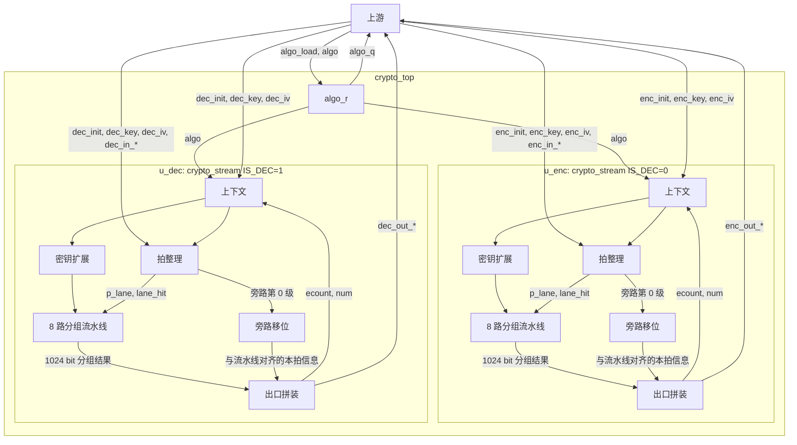
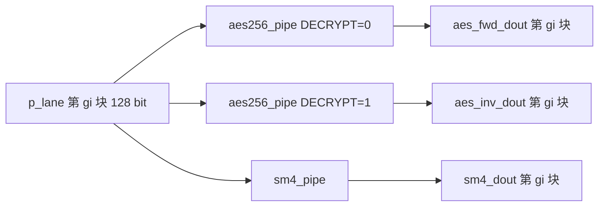

# AES-256 / SM4 设计说明

## 0. 输出目录

本设计的交付只在这两个路径：

| 内容 | 路径 |
| --- | --- |
| 本说明 | `/home/shilei/project/FPGA/crypto/spec/aes_sm4_design_spec.md` |
| 功能 RTL | `/home/shilei/project/FPGA/crypto/rtl/` |

`crypto/rtl/` 内的文件：

- `crypto_top.v`：顶层。算法装入，例化加密流和解密流
- `crypto_stream.v`：一条 1024 bit 流。上下文、ECB/CTR、8 路调度
- `aes256_key_expand.v`、`aes256_pipe.v`：AES-256 密钥扩展和单路流水线
- `sm4_key_expand.v`、`sm4_pipe.v`：SM4 密钥扩展和单路流水线
- `aes_sbox.vh`、`aes_inv_sbox.vh`、`sm4_sbox.vh`：S 盒

`/home/shilei/project/FPGA/sim/` 和 `/home/shilei/project/FPGA/tb/` 不是本设计的交付。里面的单流接口已经过时，验证由验证 agent 按第 5 节重接。

## 1. 范围

本说明只覆盖加密模块的功能 RTL：AES-256 与 SM4，模式为 ECB 和 CTR。压缩模块、PCIe、FPGA 工程（器件工程、布局布线、时序签核、ALM 预算）和仿真环境不在本次。资源核对先不做。

后续可以加模式。分组运算和模式调度分开，加模式时不改单路流水线的对外行为。

## 2. 参考模型

对齐 OpenSSL `master`：

- commit：`2506f1fc323b567b0e48a13b6069c7778077e55e`
- 日期：2026-10-12
- 链接：https://github.com/openssl/openssl/commit/2506f1fc323b567b0e48a13b6069c7778077e55e

后续对拍以这个 commit 为准，不跟随 `master` 移动。换 commit 时只改本节。

采用的源文件：

| 行为 | 文件 |
| --- | --- |
| AES 分组与密钥扩展 | `crypto/aes/aes_core.c`，FIPS-197 |
| AES ECB 单分组 | `crypto/aes/aes_ecb.c` |
| SM4 分组与密钥扩展 | `crypto/sm4/sm4.c` |
| CTR 计数器与尾字节 | `crypto/modes/ctr128.c` 的 `CRYPTO_ctr128_encrypt` |
| 密钥、IV 在上下文里如何保留 | `providers/implementations/ciphers/ciphercommon.c` 的 `cipher_generic_init_internal` |

不实现：AES-128、AES-192、CPU 汇编、`crypto/` 里其余算法，以及 OpenSSL 列出的 CBC、CFB、OFB、GCM、CCM、XTS、OCB、SIV、WRAP。

`CRYPTO_ctr128_encrypt_ctr32` 把加 1 拆成低 32 bit 再向高 96 bit 进位，结果与 `ctr128_inc` 的 128 bit 大端加 1 相同。RTL 按后者实现。

## 3. 已冻结的行为

1. AES-256 和 SM4 都做 ECB、CTR。算法运行时二选一，整模块共用一个 `algo`。
2. 每路内部 AES 与 SM4 的轮函数不合并。`algo` 选择把分组送进哪一组流水线。
3. 数据按字节流处理，不要求 1024 bit 对齐。
4. CTR 计数器与 `CRYPTO_ctr128_encrypt` 一致。
5. 密钥和 IV 按 OpenSSL 上下文语义，不按“每包自动更换”。
6. 核内不做 EVP 的 PKCS#7 填充。`aes_ecb.c` 只处理整分组；填充属于 `crypto/evp`。
7. 加密流和解密流同时工作，各有一套数据口和一套上下文。整拍对齐且 `out_ready=1` 时，每条流每个时钟接收 8 个分组。模式按流选择，算法不能按流选择。

## 4. OpenSSL 里报文和密钥怎么处理

OpenSSL 没有 1024 bit 拍，也没有“包”。`EVP_EncryptUpdate` 接收任意字节长度。

CTR（`ctr128.c`）：

- 计数器是 16 字节，按大端整数每生成一个分组加 1。先加密当前计数器，再加 1，再与明文异或。
- 最后不足 16 字节时，仍然生成并消耗这一块密钥流：异或有效字节，`num` 记下用到第几个字节，剩余密钥流留在 `ecount_buf`。
- 下一次 Update 从 `ecount_buf[num]` 继续。`num` 回到 0 之后才生成下一块。
- 加解密使用同一套加密轮函数。

ECB：

- 凑满 16 字节才输出一块。不足一块的字节留在上下文里，和 `EVP_EncryptUpdate` 在关闭填充时的缓冲相同。
- `in_last=1` 且缓冲里仍有余数时，置 `err_ecb_tail`。这对应 `EVP_EncryptFinal` 在 `EVP_CIPH_NO_PADDING` 下失败。
- 解密使用逆密码（AES）或逆序轮密钥（SM4）。

密钥和 IV（`cipher_generic_init_internal`）：

- OpenSSL 不规定每包换钥还是一直保持。调用方每次 Init 决定传不传新值。
- `key != NULL` 时更换密钥；`key == NULL` 时保持原密钥。
- `iv != NULL` 且不是 ECB 时更换 IV。ECB 没有 IV。
- 每次 Init 都把 `num` 和 ECB 缓冲长度清零。CTR 因此丢弃未用完的密钥流。
- CTR 在 Init 且 `iv == NULL` 时，不把计数器恢复成最初的 IV，运行中的计数器保持不变。CBC/CFB/OFB 才会从原始 IV 恢复；这两种模式本次不做。

RTL 的 `init` 对应 Init，数据拍对应 Update。

## 5. 接口

时钟上升沿采样，复位低有效、同步。顶层是 `crypto_top`。

算法口全模块一份：

| 信号 | 方向 | 含义 |
| --- | --- | --- |
| `algo_load` | in | 请求装入 `algo` |
| `algo[1:0]` | in | `0` AES-256，`1` SM4。其他值忽略 |
| `algo_ready` | out | 两条流都 `idle` 时为 1。只有这时 `algo_load` 才会改变 `algo_q` |
| `algo_q[1:0]` | out | 当前算法。复位后为 AES-256 |

两条流的信号同名，加密流加前缀 `enc_`，解密流加前缀 `dec_`。下表省略前缀。

| 信号 | 方向 | 含义 |
| --- | --- | --- |
| `init` | in | 装入本流上下文。只在本流 `idle` 时采样 |
| `mode[1:0]` | in | `0` ECB，`1` CTR。`2` 和 `3` 置 `err_mode`，数据不接收 |
| `key_valid` / `key[255:0]` | in | `init` 且 `key_valid` 时更换本流密钥 |
| `iv_valid` / `iv[127:0]` | in | `init`、`iv_valid` 且 `mode` 为 CTR 时更换计数器初值。ECB 的 Init 不改计数器 |
| `in_valid` / `in_ready` |  | 输入握手 |
| `in_data[1023:0]` | in | 本拍数据，最多 128 字节 |
| `in_keep[127:0]` | in | `keep[127]` 是本拍第 1 个字节。必须是从高位开始的连续 1 |
| `in_last` | in | 本次 Update 的最后一拍。不清除 CTR 计数器 |
| `out_valid` / `out_ready` |  | 输出握手 |
| `out_data` / `out_keep` / `out_last` | out | 与 `out_valid` 同一拍有效的组合输出 |
| `err_mode` / `err_no_key` / `err_keep` / `err_ecb_tail` | out | 粘滞到本流下一次 `init` |

没有单独的 `enc` 脚。方向由走哪一条流决定。

字节序：总线上的字节 0 放在最高 8 bit。AES-256 使用全部 32 字节 `key[255:0]`，字节 0 在 `key[255:248]`。SM4 只用前 16 字节 `key[255:128]`。

`idle` 是流内部状态：流水线里没有未取走的结果，并且没有在等 CTR 尾块密钥流。复位后为 1，此时还没有密钥，`in_ready` 为 0。先 `init` 装入密钥，再送数据。

`in_ready` 在下面四条同时成立时为 1：已经装过密钥、模式是 ECB 或 CTR、没有在等尾块密钥流、`out_valid=0` 或 `out_ready=1`。它不看 `init`。整拍对齐时可以每个时钟接收一拍。`out_ready=0` 只停本流。

`init` 只在本流 `idle` 时被采样。采样的这一拍，上游不得同时拉高 `in_valid`。这是接口约束，不是 OpenSSL 的加解密结果。激励按此驱动。`init` 为 1 但本流不是 `idle` 时，`init` 被忽略，数据握手照常进行。

若采样 `init` 的同一拍仍然出现 `in_valid`：RTL 只更新上下文，不收下这拍数据，`in_ready` 仍可能为 1。验证把这一点当作规格与 RTL 的核对项，不把它写成参考模型的正确行为。

`in_keep` 不是前缀时置 `err_keep`，本拍不接收。未装过密钥就送数据时置 `err_no_key`。

CTR 的输出字节数等于本拍输入字节数。ECB 只输出新凑满的分组，所以一拍的输出可以短于输入；跨拍缓冲最多 15 字节，一拍输出不超过 128 字节。ECB 余数不进流水线，缓冲当拍更新。

`out_data`、`out_keep`、`out_last` 在 `out_valid=1` 的当拍就有效。`out_ready=1` 时，下一个时钟沿取走这一拍。

### 5.1 加密通路输入

端口前缀是 `enc_`。`enc_in_data` 上是明文。数据总线、字节序和握手与解密通路相同，见本节前面的信号表。算法由 `algo` 选择，不编进数据拍。

| | AES-256（`algo=0`） | SM4（`algo=1`） |
| --- | --- | --- |
| 数据宽度 | `enc_in_data[1023:0]`，一拍最多 128 字节。第 1 字节在 `[1023:1016]` | 与 AES-256 相同 |
| 接口协议 | `enc_in_valid && enc_in_ready` 收一拍。`enc_in_keep[127]` 起连续 1 的个数为本拍字节数。`enc_in_last` 是本次 Update 的最后一拍 | 与 AES-256 相同 |
| 密钥 | 32 字节，`enc_key[255:0]`，字节 0 在 `[255:248]` | 16 字节，只用 `enc_key[255:128]`，字节 0 在 `[255:248]`。`enc_key[127:0]` 不参与 |
| 分组 | 16 字节 | 16 字节 |
| ECB | 明文按字节接成 16 字节分组再加密。本拍可以不是 16 的倍数，尾巴最多留 15 字节到下一拍 | 与 AES-256 相同 |
| CTR | 明文按字节与密钥流异或。可以不足 16 字节。`enc_iv[127:0]` 是 16 字节计数器初值，字节 0 在 `[127:120]` | 与 AES-256 相同 |

### 5.2 解密通路输入

端口前缀是 `dec_`。`dec_in_data` 上是密文。位宽、字节序、`valid/ready`、`keep`、`in_last` 与加密通路相同。

| | AES-256（`algo=0`） | SM4（`algo=1`） |
| --- | --- | --- |
| 数据宽度 | `dec_in_data[1023:0]`，一拍最多 128 字节。第 1 字节在 `[1023:1016]` | 与 AES-256 相同 |
| 接口协议 | `dec_in_valid && dec_in_ready` 收一拍。`dec_in_keep[127]` 起连续 1 的个数为本拍字节数。`dec_in_last` 是本次 Update 的最后一拍 | 与 AES-256 相同 |
| 密钥 | 32 字节，`dec_key[255:0]` | 16 字节，只用 `dec_key[255:128]` |
| 分组 | 16 字节 | 16 字节 |
| ECB | 密文按 16 字节分组做 AES 逆变换。不足 16 字节的尾巴留到下一拍 | 密文按 16 字节分组做 SM4，轮密钥逆序。字节切分方式与 AES-256 相同 |
| CTR | 密文按字节与密钥流异或，用 AES 正变换。`dec_iv` 与加密时的计数器初值相同 | 密文按字节与密钥流异或，用 SM4 正变换。`dec_iv` 同样是 16 字节 |

## 6. 实现框图与模块说明

`crypto_top` 只做算法装入，并例化两条互不共用的 `crypto_stream`。加密流 `IS_DEC=0`，解密流 `IS_DEC=1`。一条流内部的上下文、拍整理、旁路和出口拼装写在 `crypto_stream` 里，密钥扩展和单路分组是独立模块。

一条流里，第 `gi` 路（`gi` 从 0 到 7）的分组从 `p_lane` 的高位起切 128 bit。加密流只例化 AES 正变换。解密流再例化 8 路 AES 逆变换。SM4 两条流都例化，解密由 `decrypt` 选择轮密钥顺序。

### 6.1 `crypto_top`

锁存全模块算法，把两条流的端口原样接到 `crypto_stream`。

- 复位后 `algo_q` 为 AES-256。
- `algo_ready` 等于两条流的 `idle` 相与。`algo_load` 且 `algo_ready` 且 `algo` 为 0 或 1 时，下一拍 `algo_q` 更新。
- `idle` 不出顶层。上游用 `algo_ready` 判断两条流是否都能换算法。单条流的 `init` 只看本流是否空闲，另一条流可以同时在跑。

`crypto_top` 与每条 `crypto_stream` 的接口就是第 5 节去掉前缀后的那一组信号，另加 `algo[1:0]` 和 `idle`。`algo` 接 `algo_q`。

### 6.2 `crypto_stream`

参数 `IS_DEC` 决定这条流是加密还是解密。模块里有四块逻辑。

上下文。`init` 且本流 `idle` 时写入。保存 `mode_q`、`key_q`、`key_set`、CTR 计数器 `ctr`、`num`（`ctr_num`）、未用完的密钥流 `ecount`、ECB 余数字节数 `ecb_n` 和余数字节 `ecb_hold`，以及 `wait_ks` 和四个粘滞错误。每次 `init` 把 `num`、ECB 缓冲和错误清掉。`key_valid` 时更换 `key_q`。`iv_valid` 且本次 `mode` 为 CTR 时更换 `ctr`。

拍整理。组合逻辑，看当前 `in_*` 和上下文，算出本拍要送进流水线的 8 个分组 `p_lane[1023:0]`，以及跟这一拍一起走的旁路。它不寄存。

旁路移位。32 级，与流水线同一个 `pipe_en`。第 0 级在接收沿写入本拍信息，以后每拍前进一步。AES 在第 14 级取样，SM4 在第 31 级取样。单路模块的 `valid_out` 不接到拼装，出口有效看旁路。

出口拼装。组合逻辑。旁路到达取样级时，把对应路的流水线输出拼成 `out_data`，并按输出字节数生成 `out_keep`。CTR 尾块在这一拍把剩余密钥流写回 `ecount` 和 `num`。

`pipe_en` 在 `out_valid=0` 或 `out_ready=1` 时为 1。它同时停住本流全部流水线和旁路。

### 6.3 `aes256_key_expand`

组合电路。输入本流 `key_q[255:0]`，输出 15 个 128 bit 轮密钥 `rk[1919:0]`。`rk[1919:1792]` 是第 0 轮，`rk[127:0]` 是第 14 轮。8 路 AES 流水线共用这一份。扩展规则与 FIPS-197 的 AES-256 相同：`Nk=8`，`Nr=14`。

### 6.4 `aes256_pipe`

参数 `DECRYPT`。每级一轮，15 级，`en=1` 时每拍进入一个分组。

| 端口 | 宽度 | 来自 / 去向 |
| --- | --- | --- |
| `clk`，`rst_n`，`en` | 1 | `en` 接本流 `pipe_en` |
| `valid_in` | 1 | 本路被选中，且算法、方向与本实例一致 |
| `din` | 128 | `p_lane` 的第 `gi` 块。CTR 时是计数器，ECB 时是数据分组 |
| `rk` | 1920 | 本流 `aes256_key_expand` 的 `rk` |
| `dout` | 128 | 拼进 `aes_fwd_dout` 或 `aes_inv_dout` 的第 `gi` 块 |
| `valid_out` | 1 | 本模块有输出，`crypto_stream` 不使用 |

`DECRYPT=0`：第 0 级做 `din` 与第 0 轮密钥异或，中间 13 级是 SubBytes、ShiftRows、MixColumns、AddRoundKey，第 14 级不做 MixColumns。`DECRYPT=1`：从第 14 轮密钥开始做逆序，最后一级用第 0 轮密钥并且不做 InvMixColumns。S 盒来自 `aes_sbox.vh` 和 `aes_inv_sbox.vh`。

### 6.5 `sm4_key_expand`

组合电路。输入 `key_q[255:128]`，这 16 字节的字节 0 在 `key[127:120]`。输出 32 个 32 bit 轮密钥 `rk[1023:0]`。`rk[1023:992]` 是第 0 轮，`rk[31:0]` 是第 31 轮。系统参数 FK 和固定参数 CK 与 GB/T 32907 相同。8 路 SM4 流水线共用这一份。

### 6.6 `sm4_pipe`

每级一轮，32 级。`decrypt=1` 时第 0 级用第 31 个轮密钥，之后递减；`decrypt=0` 时从第 0 个轮密钥递增。32 轮结束后把 4 个字反序，得到与 OpenSSL `ossl_sm4_encrypt` 相同的字节序。S 盒来自 `sm4_sbox.vh`。

| 端口 | 宽度 | 来自 / 去向 |
| --- | --- | --- |
| `clk`，`rst_n`，`en` | 1 | `en` 接本流 `pipe_en` |
| `valid_in` | 1 | 本路被选中且 `algo` 为 SM4 |
| `decrypt` | 1 | 解密流且 `mode_q` 为 ECB 时为 1。分组在流水线内时保持不变 |
| `din` | 128 | 与 AES 同一块 `p_lane` 切片 |
| `rk` | 1024 | 本流 `sm4_key_expand` 的 `rk` |
| `dout` | 128 | 拼进 `sm4_dout` 的第 `gi` 块 |
| `valid_out` | 1 | `crypto_stream` 不使用 |

### 6.7 每条流实际例化的流水线

| 流 | AES 正变换 | AES 逆变换 | SM4 |
| --- | --- | --- | --- |
| 加密流 | 8 | 0，`aes_inv_dout` 接 0 | 8，`decrypt=0` |
| 解密流 | 8，CTR 时使用 | 8，ECB 时使用 | 8，ECB 时 `decrypt=1`，CTR 时 `decrypt=0` |

同一拍只有一组 `valid_in` 为 1。AES 时 SM4 的 `valid_in` 为 0，SM4 时两套 AES 的 `valid_in` 为 0。解密流上，CTR 只打开正变换，ECB 只打开逆变换。

## 7. 数据通路

下面按一拍数据从顶层输入走到顶层输出的顺序写。加密流和解密流各自走一遍，互不等待。

### 7.1 装入算法

上游在 `algo_ready=1` 时给出 `algo` 和 `algo_load`。`crypto_top` 把值锁进 `algo_r`，经 `algo` 同时送给两条 `crypto_stream`。此后每一拍的算法选择都看这个寄存器，直到两条流再次同时空闲。

### 7.2 装入一条流的上下文

上游对本流发 `init`。该流 `idle` 时，上下文写入 `mode_q`，按 `key_valid`、`iv_valid` 更新密钥和 CTR 初值，并清空 `num`、ECB 余数和错误。这一拍不拉 `in_valid`。密钥扩展是组合电路，`key_q` 更新后，同一拍之后的 `rk` 就是新密钥的轮密钥。数据拍从下一拍开始，在 `key_set=1` 且 `in_ready=1` 时送入。

### 7.3 接收顶层数据拍

上游拉高 `in_valid`，并给出 `in_data`、`in_keep`、`in_last`。`crypto_stream` 先数 `in_keep` 从 `keep[127]` 起的连续 1，得到本拍字节数。出现 0 之后又出现 1，则置 `err_keep`，本拍不进流水线。还没有密钥就送数据，置 `err_no_key`。

`in_ready` 为 1 时，上升沿接收。接收后做两件事：上下文按本拍结果更新，旁路第 0 级写入本拍信息。`p_out_len=0` 的拍不写入旁路，也不打开任何一路的 `valid_in`。

### 7.4 拍整理

CTR：

1. 若 `num` 不为 0，先用 `ecount` 里剩余的密钥流异或输入前面的字节。这些字节放进 `p_pre`，不进流水线。
2. 剩下的字节按 16 字节切块，最多 8 块。第 `gi` 块写入 `p_lane` 的是计数器 `ctr+gi`，不是明文。同时记下这块明文在 `in_data` 里的起始字节，以及这块实际使用的字节数。
3. 计数器加上本拍新产生的块数，写回 `ctr`。
4. 最后一块不足 16 字节时，置 `wait_ks`，`in_ready` 变 0。`num` 和 `ecount` 要等这块密钥流到达出口才写。整块则立刻把 `num` 写成余数用完后的值，通常是 0。
5. 本拍输出字节数等于输入字节数。

ECB：

1. 把上次留下的 `ecb_hold` 放在本拍输入前面，凑字节队列。队列最长 143 字节，完整分组最多 8 块。
2. 每 16 字节组成一个数据分组，写入 `p_lane`。流水线加密或解密的就是这个分组。
3. 不足 16 字节的尾巴写回 `ecb_hold`，当拍完成，不进流水线。
4. `in_last=1` 且仍有尾巴时置 `err_ecb_tail`。
5. 本拍输出字节数是 16 乘以完整分组数。只有尾巴的拍输出长度为 0，顶层不会为它产生 `out_valid`。

旁路第 0 级保存的内容：是否有效、`in_last`、是不是 CTR、是否为尾块、尾块在第几路、尾块用到的字节数、分组个数、`p_pre` 及其长度、输出字节数、原始 `in_data`、每路字节数和每路在 `in_data` 中的起点。

### 7.5 送入 8 路流水线

`lane_hit[gi]` 表示本拍第 `gi` 路有一个新分组。它和算法、模式一起决定哪一个流水线实例的 `valid_in` 为 1。

| 条件 | `valid_in` 打开的实例 | `din` |
| --- | --- | --- |
| `algo` 为 AES，加密流，或解密流且模式为 CTR | 该路 `aes256_pipe`，`DECRYPT=0` | CTR 为计数器，ECB 为数据分组 |
| `algo` 为 AES，解密流且模式为 ECB | 该路 `aes256_pipe`，`DECRYPT=1` | 数据分组 |
| `algo` 为 SM4 | 该路 `sm4_pipe` | 同上。`decrypt` 仅在解密流 ECB 时为 1 |

`en` 就是本流 `pipe_en`。接收沿把 `din` 取入第 0 级，之后每拍做一轮并前移。AES 接收沿算第 1 拍，第 15 拍结果在 `dout`。SM4 第 32 拍结果在 `dout`。8 路共用同一份 `rk`，各路的 `din` 不同。

`out_ready=0` 且出口仍有未取走的拍时，`pipe_en=0`，本流各级保持原值。另一条流的 `pipe_en` 单独计算。

### 7.6 出口拼装并回到顶层

旁路与分组用同一个 `pipe_en` 前移，所以 AES 结果和旁路同时到达第 14 级，SM4 同时到达第 31 级。这一拍：

- `out_valid` 等于该级旁路有效。
- CTR：先放上 `p_pre` 里已经异或好的字节，再按旁路记下的起点和字节数，把 `in_data` 的明文字节与对应路 `dout` 异或，接在后面。`dout` 是计数器的加密结果，也就是密钥流。
- ECB：按路把 `dout` 放进 `out_data`。AES 解密流取 `aes_inv_dout`，其余 AES 取 `aes_fwd_dout`，SM4 取 `sm4_dout`。
- `out_keep` 从 `keep[127]` 起置输出字节数个 1。`out_last` 等于接收时的 `in_last`，并且该拍没有 ECB 尾巴错误。
- CTR 尾块在取走这一拍的时钟沿，用尾块那一路的 `dout` 更新 `ecount`，把 `num` 写成已用字节数，并清除 `wait_ks`。再下一个时钟沿才能接收新的一拍。

`out_data`、`out_keep`、`out_last` 与 `out_valid` 同一拍有效。`out_ready=1` 时，下一个时钟沿取走这一拍，旁路在取样级的下一级被清掉，不再继续往下走。

`crypto_stream` 的这些输出经 `crypto_top` 加上 `enc_` 或 `dec_` 前缀，成为顶层输出。两条流可以在同一个时钟各自给出一拍 `out_valid`。

整 16 字节对齐的拍在 `out_ready=1` 时每个时钟都能接收，填满流水线之后每个时钟都有一拍输出。CTR 尾块会使本流停住，停住的时间就是本算法的流水线深度。

加 CBC、GCM 等模式时，只在每条流的拍整理和出口拼装上增加模式状态。单路流水线仍然只接收 128 bit 并给出 128 bit。结构取自 `crypto/spec/duplex_feasibility.md`。那份记录里的 ALM 估算不作为本版 RTL 的门禁。
